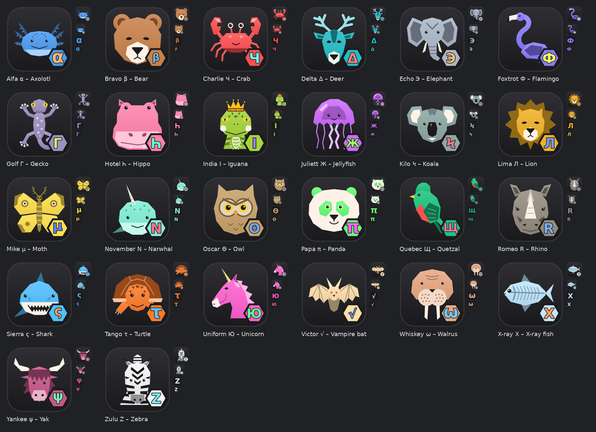

# Taskbar Zoo

26 distinct app icons, one per ICAO phonetic-alphabet name (Alfa, Bravo, Charlie …), for telling
apart several copies of the same app on a taskbar or dock — browser installs or profiles, editor
instances, VMs, terminals, and so on. Each icon has an animal on a shared charcoal tile, with its letter
in a hexagon badge, drawn in the animal colour's complement so it stands out on any taskbar.



## The set

| Name | Letter | Animal | Colour |
|---|---|---|---|
| Alfa | α | Axolotl | `#4a9af0` |
| Bravo | β | Bear | `#c98049` |
| Charlie | Ч | Crab | `#ff4f4f` |
| Delta | δ | Deer | `#22bcc6` |
| Echo | ε | Elephant | `#aab6c8` |
| Foxtrot | Ф | Flamingo | `#8a7cff` |
| Golf | Γ | Gecko | `#9d8fc0` |
| Hotel | Η | Hippo | `#ff80aa` |
| India | I | Iguana | `#a6d63a` |
| Juliett | Ж | Jellyfish | `#cf6bff` |
| Kilo | Ϟ | Koala | `#9fc7e8` |
| Lima | Λ | Lion | `#f2b124` |
| Mike | μ | Moth | `#ffe04a` |
| November | N | Narwhal | `#7ff0d6` |
| Oscar | Θ | Owl | `#c9a26a` |
| Papa | π | Panda | `#59e0a0` |
| Quebec | Щ | Quetzal | `#19c37d` |
| Romeo | ρ | Rhino | `#d4714a` |
| Sierra | Σ | Shark | `#4fc0ff` |
| Tango | τ | Turtle | `#ff7b29` |
| Uniform | Ю | Unicorn | `#ff5fd0` |
| Victor | √ | Vampire bat | `#5cc055` |
| Whiskey | ω | Walrus | `#e8a882` |
| X-ray | Ξ | X-ray fish | `#bfe8ff` |
| Yankee | ψ | Yak | `#c9568a` |
| Zulu | Z | Zebra | `#f4f4f4` |

## About the letters

Each name gets a Greek or Cyrillic letter that sounds or looks like its initial. Where that would
look too much like another icon's letter at 16 px, distinctness won over accuracy:

- **Greek where it fits:** α β δ ε Γ Η Λ μ π ρ Σ τ ψ — mostly lowercase, with capitals where the
  lowercase form looked too much like a Latin letter (Η, Γ) or simply read better (Λ, Σ).
- **Cyrillic for Charlie, Foxtrot, Juliett and Uniform:** Ч (*ch*), Ф (*f*), Ж (*zh*) and Ю (*yu*,
  as in the start of "Uniform").
- **Kilo — Ϟ:** koppa, an archaic Greek *k*-type letter, in its later lightning-bolt form. Chosen over κ,
  which looked too much like Ж at small sizes.
- **Oscar — Θ:** theta, used for its shape; a plain O was too close to α when tiny.
- **Quebec — Щ:** neither alphabet has a Q, so this is purely a bold, distinctive shape (it's
  pronounced roughly *shch*). The historically "correct" letter, Ϙ (koppa, the ancestor of Latin Q),
  is the same letter as Kilo's Ϟ and looks too much like Θ.
- **Victor — √:** a square-root sign, because a V looked like a mirrored Λ. Nod to math class.
- **Whiskey — ω:** omega, for its *w*-like shape rather than its sound.
- **X-ray — Ξ:** xi, pronounced *ks*, the same sound as X.
- **India, November, Zulu — I, N, Z:** plain Latin letters, kept where they were already distinct.

## Repository layout

```
icons.json        name → letter, animal, colour (optional: centre offset, display title like "X-ray")
art/*.svgfrag     the animal drawings (SVG snippets using colour tokens)
svg/              generated master SVGs — the files to use or convert
  <name>.svg                 full icon (animal + badge), used for 32 px and up
  <name>-small.svg           letter-only version, used for 16 and 24 px
tools/build.py    regenerates everything
tests/            tests for build.py (need only Pillow)
build.sh          convenience wrapper
previews/         contact sheets of the whole set
dist/             (git-ignored) PNG / ICO / ICNS output
```

The SVGs in `svg/` are self-contained: letters are stored as outlines, so they render identically
without any fonts installed.

## Building

```sh
./build.sh            # SVGs -> dist/ (PNG 16–1024, ICO, ICNS) + previews
./build.sh --full     # also regenerate svg/ from art/ + icons.json first
```

Or step by step: `python3 tools/build.py svg|export|previews|all [names…]`. Names limit `svg` and
`export`; `previews` always draws the full set from `dist/`, so it needs every icon exported first.

Requirements:

- **export** (SVG → PNG/ICO/ICNS): `rsvg-convert` (librsvg) and Python 3 with Pillow
- **svg** (art → SVG, only needed after editing art or icons.json): also `fontTools` and the
  DejaVu Sans Bold font (set `ICON_FONT=/path/to/DejaVuSans-Bold.ttf` if it isn't found)
- **previews**: Pillow and DejaVu Sans (regular), looked for next to `ICON_FONT` and in the usual
  font folders

```sh
# Debian/Ubuntu
sudo apt install librsvg2-bin fonts-dejavu-core && pip install -r requirements.txt
# macOS
brew install librsvg && pip3 install -r requirements.txt   # plus DejaVu Sans from dejavu-fonts.github.io
```

Tests: `python3 -m unittest discover -s tests`. They need only Pillow: small stand-ins replace
rsvg-convert and the font. They also check that `svg/` is up to date with `art/` and `icons.json`,
and on a Mac they round-trip the `.icns` output through Apple's `iconutil`.

## Editing

- **Change a colour or letter:** edit `icons.json`, then `./build.sh --full`.
- **Redraw an animal:** edit `art/<name>.svgfrag`. Draw on a 512×512 canvas with these colour tokens:
  `MAIN` (icon colour, rendered as a gradient), `SHADE` (darker), `LIGHT` (lighter), `CREAM`, `DARK`.
  Size and position don't matter; each drawing is measured and auto-fitted to the tile.
  Side-profile animals face left, away from the badge.

## Using the icons

- **Linux:** in the app's `.desktop` file, set `Icon=` to the SVG or the 256/512 PNG.
- **Windows:** shortcut → Properties → Change Icon → choose the `.ico`. If a pinned taskbar icon keeps
  the app's original logo, unpin it, change the icon on the shortcut, then pin the shortcut again.
- **macOS:** Get Info on the app, then drag the `.icns` (or the 1024 PNG) onto the small icon at top left.

## Licence

Not yet chosen. Add a `LICENSE` file before publishing.
